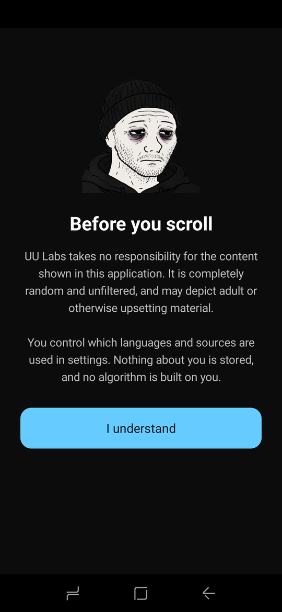
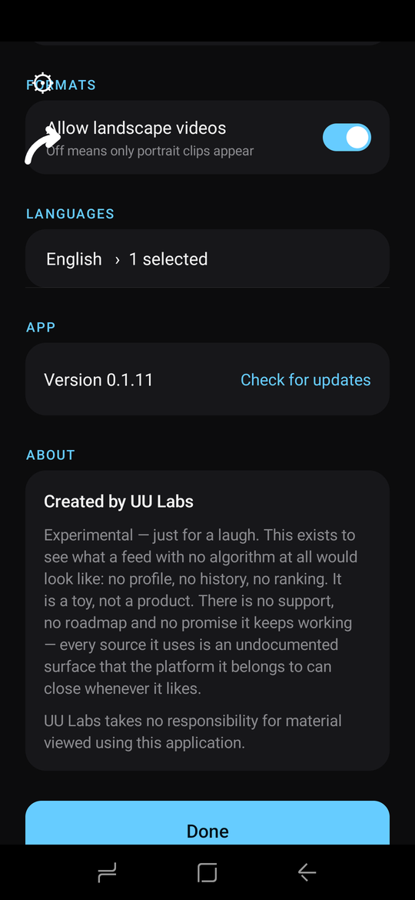
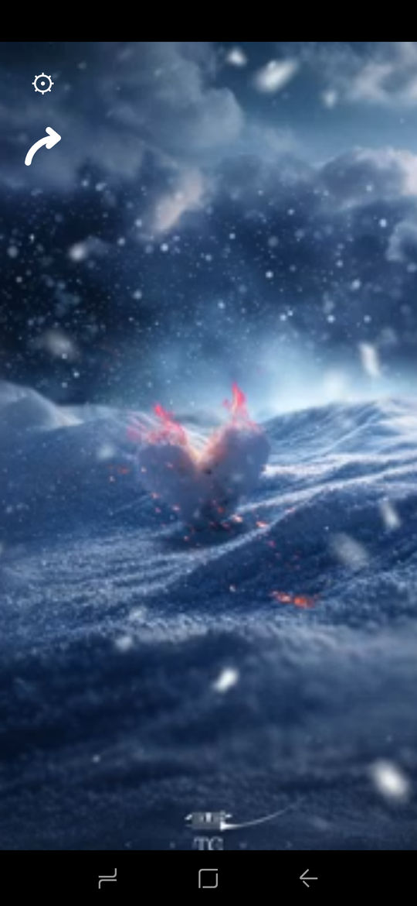
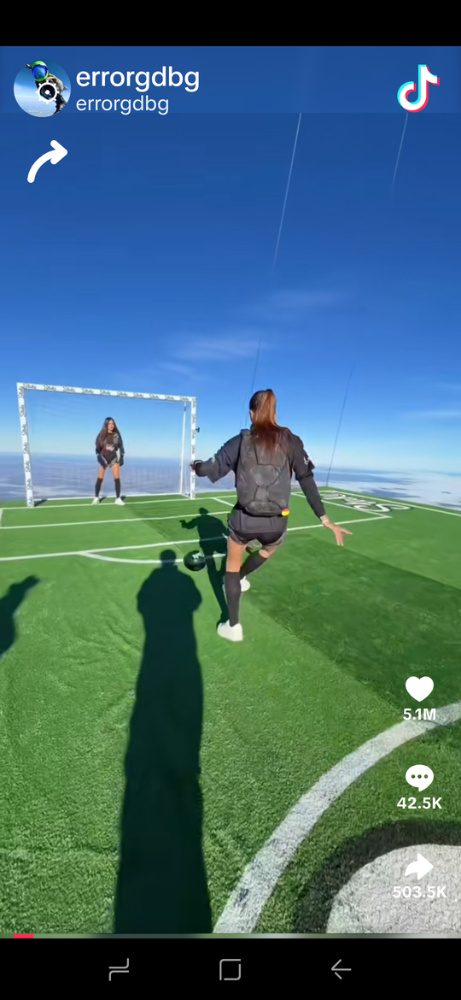

# UU Doomscroller

A serverless, keyless, login-free Android app that plays an endless random portrait
video feed assembled from several public sources.

> **Experimental, and just for a laugh.** This exists to see what a feed with no
> algorithm at all would look like: no profile, no history, no ranking. It is a
> toy, not a product. There is no support, no roadmap and no promise it keeps
> working. Every source it uses is an undocumented surface that the platform it
> belongs to can close whenever it likes.

- **No account, no server, no API key.** Every video is found on the device at the
  moment it is needed, from a randomly chosen subject word.
- **No provider player for YouTube.** A hidden WebView runs `youtubei.js`; the
  app mediates its requests and plays the resulting stream itself, so there are no
  adverts, no subscribe button and no browser chrome.
- **Two controls.** Settings top left, share beneath it. Swipe up for the next
  video, swipe down for the previous, tap to pause.
- **Unfiltered by design.** A first-run notice says so before anything plays.

| First run | Settings | Playing |
| --- | --- | --- |
|  |  |  |




## How it picks

Nothing is ranked, recommended or remembered about the person watching.

Each draw takes a subject at random, searches every enabled source for it and
plays whatever comes back first. Subjects are spent from a shuffled pool, so
nothing returns until everything else has been used, including across
restarts.

There is no list of videos, channels or creators anywhere. A subject decides
only what gets *asked for*, never what comes back; the results are whatever the
platform serves at that moment.

## Sources

| Source | Discovery | Playback |
| --- | --- | --- |
| YouTube | search results for a subject (Shorts only unless landscape is allowed) | native stream via `youtubei.js` |
| TikTok | sitemap / tag embeds | TikTok's own embeddable player |
| X | syndication timeline | direct mp4 |
| PeerTube | Sepia Search + per-instance lookup | HLS via ExoPlayer |
| Instagram | reel permalinks from a search index | media URL read from the embed, played natively |
| Facebook | reel permalinks from a search index | mp4 read from the video plugin, played natively |

Instagram and Facebook are found through a search index rather than the platform
itself, which has no anonymous discovery, and both play in our own player so no
account header or comment bar is shown. That index throttles, so they build up
supply over time. Everything above is on by default except PeerTube, whose clips
are long form and rarely portrait.

## Build

```sh
gradle :app:assembleDebug
adb install -r app/build/outputs/apk/debug/app-debug.apk
```

Requires JDK 17+, Android SDK platform 36 and Gradle 9.x. `local.properties` must
point at your SDK; it is not committed.

## Documentation

- `STATUS.md`: current state, what works, what does not, and next steps.
- `research/FINDINGS.md`: the research record behind the source choices.

## Releases

UU Doomscroller is **not published on Google Play, and will not be**. It is
distributed here as an APK.

| File | Use |
| --- | --- |
| `UUDoomscroller-<version>.apk` | The app. It checks for a newer version, downloads it and hands it to the Android installer. Recommended. |
| `UUDoomscroller-<version>-no-self-update.apk` | The same app, except it never installs anything: when a newer version exists it opens this page and you install it yourself. |

> **On Play Protect.** The self-updating build has not been flagged in testing,
> so it is treated as safe by the devices used here. That is a verdict Google
> can change whenever it likes, and "not flagged yet" is not the same as "safe".
> An app that downloads and launches an installer is, by shape, doing what a
> dropper does.
>
> If you would rather not grant that, use the second file. The only function you
> give up is in-app updating.

Both are the same app with the same signer and application id, so they install
over one another and keep your settings.

```sh
gradle :app:assembleStandardRelease
```

Verify a download with:

```sh
shasum -a 256 -c SHA256SUMS
```
